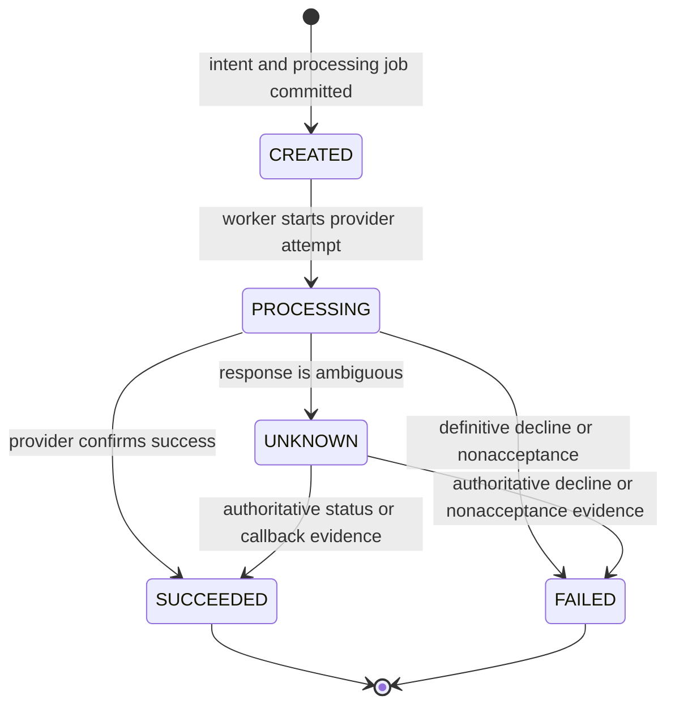

# Payment Orchestrator

Payment Orchestrator is an educational simulation of payment routing, transaction state, provider callbacks, durable work, and reconciliation. It uses synthetic data and simulated providers only.

> **Not a payment processor.** Do not use this project for real transactions or enter card numbers, CVVs, credentials, or other sensitive payment data. It is not production-ready and makes no PCI compliance claim.

## What it demonstrates

- FastAPI APIs with PostgreSQL as the authoritative store.
- Database-enforced merchant-scoped idempotency and atomic creation of payment and processing work.
- A centralized state machine with persistent transition history and terminal-state protection.
- Two deterministic simulated providers with success, decline, timeout, lost-response, and temporary-unavailability scenarios.
- A PostgreSQL durable job queue using leases and `FOR UPDATE SKIP LOCKED`; no Redis, Kafka, or separate broker.
- HMAC-authenticated, provider-specific callbacks with provider-scoped event deduplication.
- Reconciliation against the original provider attempt; an unresolved result remains `UNKNOWN`.
- A Next.js dashboard that reads live payment, attempt, event, and reconciliation data from the API.

## Architecture

```text
Browser ──> Next.js dashboard ──> FastAPI ──> PostgreSQL
                                      ▲            ▲
                                      │            │ durable jobs
                                      └──────── Python worker
```

PostgreSQL stores payment intents, provider attempts, synthetic provider records, callback events, state transitions, and durable jobs. Creating an intent and its initial processing job is one database transaction. Workers claim jobs in short transactions, perform provider work outside the claim transaction, and persist the outcome in a separate transaction. The database is the source of truth; the dashboard does not hardcode payment summaries.

### Payment lifecycle



`SUCCEEDED` and `FAILED` are terminal. Late, duplicate, or contradictory events cannot regress a terminal payment. A timeout is not proof of failure: reconciliation queries the **same provider attempt** and only resolves the payment when the simulated provider record supplies definitive evidence. If it remains inconclusive, the payment stays `UNKNOWN`; exhausted reconciliation work is visible as a dead job. The system never fails over an unresolved attempt to another provider. Per the simulation policy, confirmed provider nonacceptance resolves to `FAILED` rather than being retried through another provider.

### Data invariants

| Invariant | Enforcement |
|---|---|
| An idempotency key is unique per merchant | PostgreSQL unique constraint on `(merchant_id, idempotency_key)` |
| A repeated key with a different amount/currency is rejected | Request fingerprint comparison in the intent service |
| Payment intent, initial `CREATED` history, and initial processing job are committed together | One SQL transaction |
| Attempt numbers are unique per payment; attempts reference existing payments/providers | PostgreSQL unique constraint and foreign keys |
| Provider event IDs are unique per provider | PostgreSQL unique constraint on `(provider_id, provider_event_id)` |
| Current payment state changes only along valid, evidence-backed edges | Central state-machine service, payment row lock, and transactional history insert |
| A live job has one lease owner and lease expiry | PostgreSQL constraints plus `FOR UPDATE SKIP LOCKED`; expired leases are reclaimable |
| Provider calls do not hold a database transaction open | Worker claim and provider execution use separate transactions |
| An unresolved payment is not routed to another provider | Orchestration guard and persisted original attempt/reference |

These are educational application-level and database controls, not a production security or reliability guarantee.

## Prerequisites

- Docker Desktop with Docker Compose v2.
- Git.
- Optional for running checks on the host: Python 3.13+ and Node.js 22+ with npm.
- PowerShell 7 (`pwsh`) to run the included demo script.

No external provider account or payment credentials are needed.

## Local setup

Run these commands from the repository root in PowerShell:

```powershell
if (-not (Test-Path .env)) { Copy-Item .env.example .env }
```

The Compose stack binds PostgreSQL, API, and dashboard ports to `127.0.0.1` only. The sample configuration leaves simulation administration and callback authentication disabled. To use the protected simulation endpoint and callback demo, set three different random local-only secrets in `.env`:

```text
SIMULATION_ADMIN_TOKEN=<random local-only token>
PROVIDER_A_CALLBACK_SECRET=<different random local-only secret>
PROVIDER_B_CALLBACK_SECRET=<different random local-only secret>
```

For example, generate a random hexadecimal value with:

```powershell
python -c "import secrets; print(secrets.token_hex(32))"
```

Run it separately for each setting. These values are only for the local simulation; do not reuse production credentials.

Start the services:

```powershell
docker compose up --build -d
docker compose ps
```

The API container applies Alembic migrations before serving traffic. Verify readiness:

```powershell
Invoke-WebRequest -UseBasicParsing http://127.0.0.1:8000/ready
```

Open the live-data dashboard at <http://127.0.0.1:3000/>. Interactive API documentation is at <http://127.0.0.1:8000/docs>.

To stop services:

```powershell
docker compose down
```

To also remove the local PostgreSQL data volume and its synthetic records:

```powershell
docker compose down -v
```

## API overview

| Method | Path | Purpose |
|---|---|---|
| `GET` | `/health` | Process health |
| `GET` | `/ready` | Database readiness |
| `POST` | `/payments` | Create or idempotently retrieve an intent |
| `GET` | `/payments` | List/filter payments (`merchant_id`, `state`, `limit`, `offset`) |
| `GET` | `/payments/{payment_id}` | Retrieve a payment |
| `GET` | `/payments/{payment_id}/timeline` | View attempts, transitions, provider events, and reconciliation jobs |
| `POST` | `/simulation/payments` | Create a deterministic scenario; requires `X-Simulation-Admin-Token` |
| `POST` | `/simulation/providers/{provider_name}/callbacks` | Submit a signed simulated callback |

Payment creation accepts a synthetic `merchant_id`, positive integer `amount_minor`, uppercase three-letter `currency`, and `idempotency_key`. The unique scope is merchant plus key. Matching requests return the existing payment; payload mismatch returns HTTP 409. Payment amounts are never card data.

Simulation scenarios are `SUCCESS`, `DECLINE`, `TIMEOUT`, `SUCCESS_LOST_RESPONSE`, and `TEMPORARY_UNAVAILABLE`. Provider selection is `provider_a` or `provider_b`; provider B must be explicitly selected for the initial attempt.

Callbacks are authenticated with HMAC-SHA256 over the exact raw JSON body. Send the signature as `X-Provider-Signature: sha256=<lowercase-hex-digest>` and use the secret corresponding to the provider in the URL. Callback event IDs are deduplicated within that provider's scope.

## Reproducible demo

1. Configure the three local-only secrets above in `.env`, then start the stack.
2. From the repository root, run:

   ```powershell
   pwsh -File .\scripts\demo.ps1
   ```

The script creates fresh synthetic intents and waits for worker results. It demonstrates confirmed success, definitive decline, a lost response that reconciliation resolves using the provider's retained synthetic record, and a timeout that remains `UNKNOWN`. It then submits a signed success-shaped callback with no confirming provider record; the callback is recorded as contradictory, and sending it again is reported as a duplicate without changing the payment state. The script prints the created payment IDs; inspect their timelines in the dashboard.

The demo deliberately does **not** fabricate provider evidence to turn an uncertain outcome into success.

## Development and tests

Backend checks (run from `backend`):

```powershell
python -m pip install -e ".[test]"
python -m pytest -q
alembic check
```

Tests use a temporary PostgreSQL schema, clean it up after the run, and can be pointed at a dedicated test database with `TEST_DATABASE_URL`. The regular application database setting can also be supplied as `DATABASE_URL`. Do not point tests at a database containing data you need to preserve if the database account cannot create/drop schemas.

Frontend checks (run from `frontend`):

```powershell
npm ci
npm run lint
npm run typecheck
npm run build
```

The tests cover idempotency including concurrent duplicates and payload conflicts; state-machine edges and history consistency; provider outcomes; timeout and lost-response handling; bounded reconciliation retries; concurrent worker claims and lease recovery; interruptions after provider submission and before job acknowledgement; callback authentication, deduplication, and races; and live timeline data.

## Continuous integration

GitHub Actions runs three checks on pushes and pull requests: PostgreSQL-backed backend tests with migrations and Alembic drift validation; frontend dependency installation, lint, type-check, and production build; and Docker Compose configuration validation.

## Project boundaries

- This repository is a local educational simulation using synthetic data.
- It does not integrate with real payment providers, process real payments, or accept/store card credentials.
- Administrative/simulation controls are disabled when their secrets are unset.
- Local secrets belong in `.env`, which is ignored by Git. Never commit real secrets.
- No production, PCI compliance, or financial reliability claim is made.
